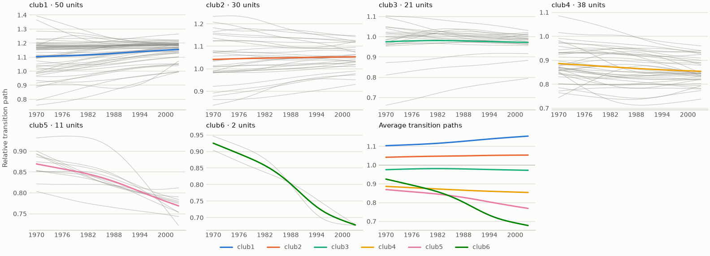
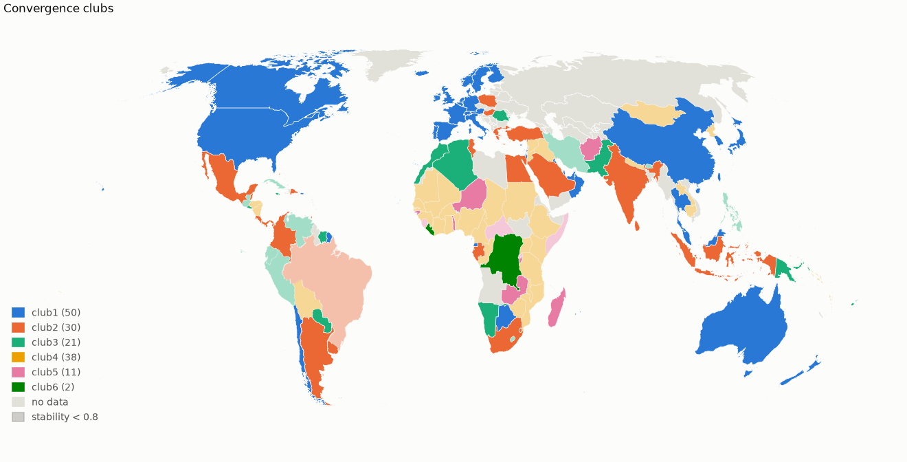
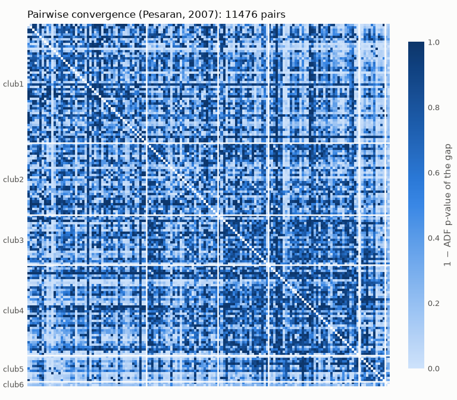

# Club convergence

Find the groups of countries or regions that converge to the same path — **convergence
clubs** — with the log t test and clustering algorithm of Phillips and Sul (2007, 2009).

This is a Python port of the R package
[ConvergenceClubs](https://github.com/rhobis/ConvergenceClubs) (Sichera and Pizzuto, 2019),
extended with robustness checks, classical convergence measures, publication-ready plots and a
one-call report:

- **matches R** to within 1e-8 on every test result and club, and **matches Stata's `psecta`**
  on all eight published classifications of Mendez (2020) with `convention="Stata"`;
- **checks its own clubs**: sensitivity to the settings, bootstrap confidence in each
  membership, and a warning when a club fails its own test;
- **puts clubs in context** with β- and σ-convergence, distribution dynamics, Pesaran's
  pairwise test and an ordered logit of club membership;
- **needs only numpy and pandas**, with optional plots, interactive charts and maps.

| Transition paths of the clubs | Clubs on a map, hatched where uncertain | Pairs converging within and between clubs |
|---|---|---|
|  |  |  |

## Installation

```bash
pip install "convergence-clubs[plot] @ git+https://github.com/bbanyuls/club-convergence"
```

The core package needs `numpy` (≥ 1.23) and `pandas` (≥ 1.5), on Python 3.10 or later. The
`plot` extra adds `matplotlib` (≥ 3.7), `interactive` adds `plotly` (≥ 5.15) and `maps` adds
`geopandas` (≥ 0.14.4). CI tests both these oldest versions and the latest ones.

## Quick start

```python
import numpy as np
import convergence_clubs as cc

gdp = cc.load_gdp()                         # 152 countries x 1970-2003, in levels
data = cc.hp_filter(np.log(gdp), lamb=400)  # log, then the trend (= cc.load_filtered_gdp())

# Does the whole panel converge? No: t is far below -1.65.
H = cc.cross_sectional_variation(data.to_numpy())
cc.log_t_test(H, time_trim=1/3)
# LogTResult(beta=-0.8748..., std_err=0.0054..., t_value=-159.55..., p_value=0.0, alpha=0.398...)

clubs = cc.find_clubs(data)      # R defaults: time_trim=1/3, c*=0, FQSB errors
clubs.summary()
#        n_units   beta  std_err  t_value  p_value  converges  cstar
# club
# club1       50  0.382    0.041    9.282    1.000       True    0.0
# club2       30  0.240    0.035    6.904    1.000       True    0.0
# club3       21  0.110    0.032    3.402    1.000       True    0.0
# club4       24  0.131    0.064    2.055    0.980       True    0.0
# club5       14  0.190    0.111    1.701    0.956       True    0.0
# club6       11  1.003    0.166    6.024    1.000       True    0.0
# club7        2 -0.470    0.842   -0.559    0.288       True    0.0

merged = clubs.merge("PS")       # club4 + club5 converge together: 6 clubs
merged.memberships()             # unit -> club, as a pandas Series
merged.plot()                    # the figure above, left

cc.bootstrap(data, 200, merge="PS", seed=0).uncertain(0.8)   # memberships to read with care
cc.report(gdp, title="GDP clubs").save("report.html")        # everything, in one HTML file
```

In Jupyter, results display as tables.

## What it does

| Task | Functions |
|---|---|
| Prepare the data | `wide_panel` (long → wide), `describe_missing`, `fill_gaps`, `balance`, `hp_filter`; two bundled panels: `load_gdp`, `load_productivity` |
| Test convergence | `log_t_test`, `cross_sectional_variation`, `relative_transition` |
| Find clubs | `find_clubs` (fixed or incremental `c*`, R or Stata `convention`), `.merge("PS" \| "vLT")`, `.merge_divergent()`, `.rename(...)` |
| Check them | `sensitivity` (grid of settings), `bootstrap` (units, business cycles or end of sample), `rolling_clubs` (clubs over time), `compare_clubs`, `adjusted_rand_index`; `n_jobs=-1` for large panels |
| Classical convergence | `beta_convergence`, `sigma_convergence`, `distribution_dynamics`, `pairwise_convergence` (ADF + KPSS) |
| Explain membership | `club_determinants` (ordered logit or probit), `spatial_clustering` (are clubs neighbours? join counts on a map) |
| Show the results | `.plot()` and 15 more plots, 4 themes (`light`, `dark`, `print`, `journal`) and your own, interactive charts, maps |
| Share them | `report` (self-contained HTML appendix), the `convergence-clubs` command line |

## Learn more

| | |
|---|---|
| [**Feature tour**](docs/feature-tour.ipynb) | Every feature, with its output — the quickest way to see what the package does |
| [**Tutorial**](docs/tutorial.ipynb) | A complete analysis, explaining how to read each result |
| [Choosing the settings](docs/guide/choosing-settings.md) | HP filter, `time_trim`, `c*`, HAC errors, merging, R or Stata, and how much each matters |
| [Finding clubs](docs/guide/clubs.md) | Bundled data, input and missing values, sorting, failing clubs, renaming, R and Stata conventions |
| [Robustness](docs/guide/robustness.md) | Sensitivity analysis, bootstrap confidence, clubs over time, large panels |
| [β, σ, dynamics, pairwise tests and determinants](docs/guide/classical.md) | The classical measures and the ordered logit of club membership |
| [Plots and maps](docs/guide/plots.md) | Every plot, themes and style, colours, interactive charts, maps, spatial clustering |
| [Report and command line](docs/guide/report-and-cli.md) | The HTML report ([example](docs/report-example.html)) and every CLI option |
| [Validation](docs/guide/validation.md) | Correspondence with the R API, tests against R and Stata, known differences |
| [References](docs/guide/references.md) | The papers behind each method |

Both notebooks are run by the test suite on every change, so their code always works.

## Development

```bash
uv sync                                  # create the environment
uv run pytest                            # run the tests (including both notebooks)
uv run ruff check . && uv run ruff format --check .
uv run mypy                              # static type checking
uv run pytest --cov                      # CI fails if coverage drops below 99%
Rscript scripts/generate_r_fixtures.R    # regenerate the R reference (needs R)
uv run python scripts/make_figures.py    # regenerate the figures in docs/
uv run python scripts/run_notebooks.py   # re-run the notebooks and save their outputs
```

CI runs the tests on Python 3.10–3.13 and on the oldest supported versions of the
dependencies; a weekly job checks the results against the current R package.

## How to cite

Please cite the software together with the methods you apply. `CITATION.cff` has the details;
GitHub's "Cite this repository" button and reference managers read it.

- the software: Banyuls, B. *convergence-clubs: club convergence analysis in Python*,
  <https://github.com/bbanyuls/club-convergence>;
- the method: Phillips and Sul (2007, 2009);
- the R package this ports, if you compare with it: Sichera and Pizzuto (2019);
- β/σ/dynamics, the Stata conventions or the bundled data: see the
  [references](docs/guide/references.md).

Changes are listed in [`CHANGELOG.md`](CHANGELOG.md).

## License

GPL-3.0-or-later. This package is a derivative of the R package ConvergenceClubs
(© Roberto Sichera and Pietro Pizzuto, GPL-3), and the bundled GDP datasets come from it.
The bundled productivity panel comes from the replication files of Mendez (2020) (MIT licence),
based on the Penn World Table 9.0 (Feenstra, Inklaar and Timmer, 2015; CC BY 4.0).
