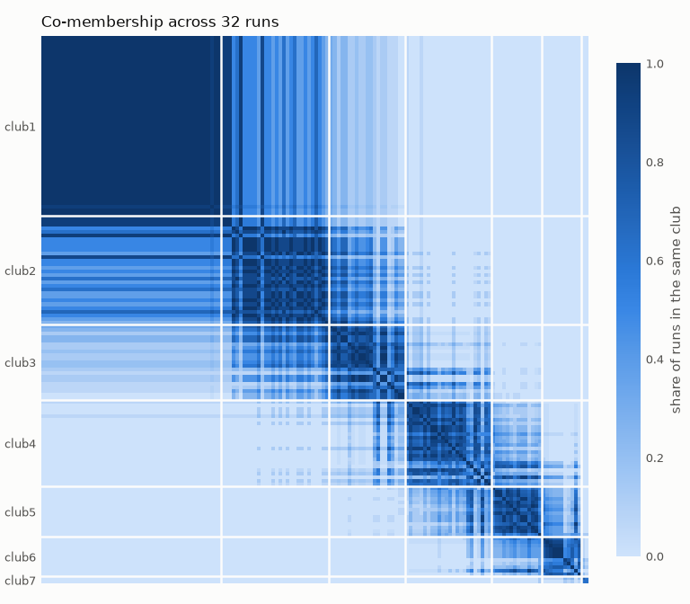
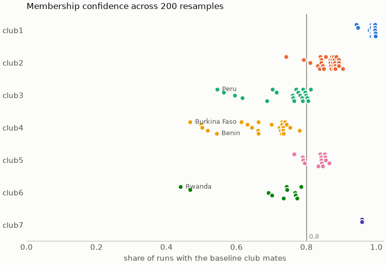

# Club convergence

Club convergence analysis in Python, following Phillips and Sul (2007, 2009).

This is a port of the R package
[ConvergenceClubs](https://github.com/rhobis/ConvergenceClubs) (Sichera and Pizzuto, 2019).
It implements:

- the **log t convergence test**, with HAC standard errors (Quadratic Spectral kernel,
  fixed or Andrews adaptive bandwidth);
- the **club clustering algorithm** (core group formation, sieving with `c*`, fixed or
  incremental);
- **club merging**, using either the Phillips and Sul (2009) rule or the von Lyncker and
  Thoennissen (2017) rule, plus merging of divergent units;
- **robustness checks**:
  - sensitivity of the clubs to `time_trim`, the HAC method, `c*`, merging and unit ordering;
  - **bootstrap confidence** in each unit's club, by resampling units, business cycles or the
    end of the sample;
  - warnings when a club fails its own convergence test;
- **classical convergence**:
  - β-convergence (absolute, conditional on controls or on clubs, and within each club), with
    the implied speed and half-life;
  - σ-convergence (the trend of dispersion over time, for the whole panel and within each club);
- **data preparation**: HP filtering, long-to-wide reshaping and handling of missing values;
- **plots** you can customize, and a **command-line tool**.

Results match the R package to within 1e-8 (see [Validation](#validation)).

## Installation

```bash
pip install "convergence-clubs[plot] @ git+https://github.com/bbanyuls/club-convergence"
```

The core package needs only `numpy` and `pandas`. The `plot` extra adds `matplotlib`.

## Quick start

```python
import numpy as np
import convergence_clubs as cc

gdp = cc.load_gdp()                         # 152 countries x 1970-2003
data = cc.hp_filter(np.log(gdp), lamb=400)  # same as cc.load_filtered_gdp()

# Does the whole panel converge?
H = cc.cross_sectional_variation(data.to_numpy())
cc.log_t_test(H, time_trim=1/3)
# LogTResult(beta=-0.8748..., std_err=0.0054..., t_value=-159.55..., p_value=0.0, alpha=0.398...)

clubs = cc.find_clubs(data, time_trim=1/3, cstar=0, hac_method="FQSB")
clubs.summary()
#        n_units   beta  std_err  t_value  p_value  cstar
# club
# club1       50  0.382    0.041    9.282    1.000    0.0
# club2       30  0.240    0.035    6.904    1.000    0.0
# club3       21  0.110    0.032    3.402    1.000    0.0
# club4       24  0.131    0.064    2.055    0.980    0.0
# club5       14  0.190    0.111    1.701    0.956    0.0
# club6       11  1.003    0.166    6.024    1.000    0.0
# club7        2 -0.470    0.842   -0.559    0.288    0.0

merged = clubs.merge("PS")       # or "vLT"; merge_divergent=True is also available
merged.summary()                 # club4 + club5 -> one club of 38 countries
merged.memberships()             # pandas Series: unit -> club
merged.units("club1")            # names of the units in a club
print(merged)                    # detailed report, like R's print()
merged.plot()                    # transition paths (see Plots below)
```

In Jupyter, a result displays as a summary table.

### Input data

Pass a `pandas.DataFrame` with **units in rows** (the index holds unique unit names) and
**time periods in columns**. Long data (one row per unit and year) can be converted with
`cc.wide_panel(df, unit="region", time="year", value="gdp_pc")`. As in Phillips and Sul,
you will usually HP-filter the log of the variable first.

**Missing values.** The procedure needs a complete panel, and the error message lists the
units that have gaps. To deal with them:
- `cc.describe_missing(df)` shows the gaps of each unit (leading, trailing, interior);
- `cc.fill_gaps(df, max_gap=2, log=True)` interpolates *interior* gaps of up to 2 periods,
  in logs;
- `cc.balance(df)` drops units that are still incomplete, and
  `cc.balance(df, "trim_periods")` instead keeps the longest run of periods that every unit
  has.

Missing values at the start or end of a series are never filled: that would invent the
transition path the test examines. Filled values also feed the HP filter, so check how they
affect the clubs with `bootstrap()` or `sensitivity()`.

Units are sorted by the last period before clustering. To sort by a different column, use
`ref_col=`. To sort by the average of the last share of periods, use `sort_fraction=0.1`,
like Stata's `psecta, fr()`; this makes the ordering less sensitive to a single year.
`data_cols=` restricts which columns are used.

For a paper table that lists the members of each club, use `clubs.summary(members=True)`.
You can then export it with `.to_latex()` or `.to_csv()`.

### Clubs that fail their own test

With the default `cstar_method="fixed"` (as in R), the procedure can accept a club even
though the club as a whole fails the log t test (t ≤ −1.65). On the GDP data this happens to
club 1 with AQSB (t = −4.98). `find_clubs` warns when this happens (`ClubConvergenceWarning`),
`summary()` has a `converges` column, and `result.failing_clubs` lists the failing clubs.
Phillips and Sul (2007) suggest raising `c*` in that case, which is what
`cstar_method="incremental"` does.

## Plots

Plotting needs the `plot` extra (matplotlib). Every plot is available from the result,
and as a function that draws into an existing `ax`:

| Call | Shows |
|---|---|
| `result.plot()` | A grid with one panel per club, then the club averages (returns a `Figure`) |
| `result.plot.club("club4")` | Every unit's path in one club, with the club average |
| `result.plot.average()` | The average transition path of each club |
| `result.plot.variation()` | Cross-sectional variation H(t) within each club. H shrinks when a club converges. |
| `result.plot.log_t("club1")` | The log t regression behind a club's test: points, fitted line, β and t |

```python
merged.plot(ncols=4)
```


```python
merged.plot(ncols=4, theme="dark", units="band")   # quantile band instead of one line per unit
```


```python
import matplotlib.pyplot as plt

fig, axes = plt.subplots(1, 2, figsize=(11, 3.8), layout="constrained")
merged.plot.average(ax=axes[0], emphasis=["club1", "club6"])   # gray out the other clubs
merged.plot.club("club4", ax=axes[1], highlight=["Bolivia", "Honduras"], reference_line=True)
```


```python
fig, axes = plt.subplots(1, 2, figsize=(11, 3.8), layout="constrained")
merged.plot.variation(ax=axes[0])
merged.plot.log_t("club1", ax=axes[1])
```


### Customizing plots

- **Colors.** `colors=["#000", ...]` (in club order) or `colors={"club2": "crimson"}`.
  Each club keeps its color in every panel, even if you plot only some of the clubs.
  The default palette has 8 colors that stay distinguishable for color-blind readers.
  From the 9th club on, the colors repeat with dashed lines, so no hard-to-distinguish new colors are added.
- **Themes.** `theme="light"` / `"dark"`, or your own `cc.Theme`, e.g.
  `cc.LIGHT.with_colors([...])`, or `dataclasses.replace(cc.DARK, font_size=11)`.
- **Grid** (`plot()`):
  - `clubs=` picks which clubs to draw;
  - `kind="clubs" | "average" | "both"`;
  - `ncols=`, `panel_size=`, `sharey=True`, `title=`, `ylabel=` and `legend=False` control the layout.
- **Club panels:**
  - `units="lines" | "band" | "none"`, with `band=(0.1, 0.9)` setting the quantiles;
  - `highlight=[unit names]`;
  - `reference_line=True` draws h = 1;
  - `unit_kws=` / `average_kws=` are passed to matplotlib.
- **Average panel:**
  - `emphasis=` keeps the chosen clubs in color and grays the rest;
  - `direct_labels=True | False | "auto"`;
  - `line_kws=` is passed to matplotlib.
- Periods on the x-axis can be numbers (years), dates, pandas periods or strings.
- Every plot is drawn from `result.transition_paths()`, so the same values are also available as a table.

## Sensitivity analysis

Club memberships depend on the trimming fraction, the HAC estimator, `c*`, merging and how
units are ordered. On the GDP data, for example, FQSB gives 7 clubs and AQSB gives 5 clubs
plus 3 divergent units. `sensitivity()` reruns the procedure over a grid of settings. The
first value of each setting forms the baseline run.

```python
runs = cc.sensitivity(
    data,
    time_trim=[1/3, 0.25, 0.3, 0.4],   # defaults
    hac_method=["FQSB", "AQSB"],       # defaults
    cstar=[0, -1],
    merge=[None, "PS"],
)
runs.table()          # one row per run: settings, clubs, sizes, agreement with the baseline (ARI)
runs.stability()      # per unit: share of runs spent with its baseline club mates
runs.co_membership()  # units x units: share of runs in the same club
runs.plot()           # heatmap below

cc.compare_clubs(a, b)          # crosstab of two results' memberships
cc.adjusted_rand_index(a, b)    # 1 = identical memberships, 0 = chance agreement
```

In the heatmap, a club that stays together in every run shows as a solid dark block. Lighter
stripes are units that change clubs between runs.



## Bootstrap confidence in club membership

`sensitivity()` varies the *settings*. `bootstrap()` perturbs the *data*, and tells you how
confident you can be that a unit belongs to its club. There are three resampling schemes:

| `method=` | What it varies | Question it answers |
|---|---|---|
| `"units"` (default) | Cluster random 80% subsets of the units | Does a unit's club depend on which other units are in the sample? |
| `"cycle"` | Block-resample the HP cyclical component and filter again (needs the *unfiltered* data and `filter_lambda=`) | Is the club robust to business-cycle noise? |
| `"endpoint"` | Drop the last 1…`max_drop` periods | Does the club hinge on the last years, where the HP filter is least reliable? |

Years are never resampled independently: the log t regression depends on the time index, so
shuffling periods would be meaningless. The cycle bootstrap uses the same blocks for every
unit, so shocks that hit all units at once stay common.

```python
runs = cc.bootstrap(data, 200, method="units", seed=0)   # ~3 s on the GDP data
runs.stability()          # each unit's confidence in its full-sample club, and runs included
runs.uncertain(0.8)       # units below 80% confidence, least confident first
runs.plot_stability()     # figure below
runs.plot()               # co-membership heatmap, as for sensitivity()

raw = np.log(cc.load_gdp())
cc.bootstrap(raw, 200, method="cycle", filter_lambda=400, merge="PS", seed=0)
```



On the GDP data, Somalia, Burkina Faso and Vanuatu are among the 8 least confident units
under all three schemes. Club 1 is solid when units are resampled (every member ≥ 0.94) and
fairly solid under cycle resampling (≥ 0.80). Dropping the last years, however, moves some of
its members (down to 0.45), so the end of the sample matters for the top club.

## β-convergence

β-convergence (Barro and Sala-i-Martin, 1992) asks whether poorer units grow faster. It
regresses average growth on the initial log level:

    g_i = (ln y_iT − ln y_i0) / T = a + β ln y_i0 (+ controls) + e_i

β < 0 means convergence, at speed λ = −ln(1 + βT)/T and with half-life ln 2 / λ. When the
whole panel does *not* converge but units within groups do, that is exactly the situation
that convergence clubs describe.

```python
gdp = cc.load_gdp()                                  # levels, not HP-filtered
cc.beta_convergence(gdp)                             # absolute: β, s.e., t, p, speed, half-life
cc.beta_convergence(gdp, controls=covariates)        # conditional on covariates (indexed by unit)
fit = cc.beta_convergence(gdp, clubs=merged, club_effects=True)   # club intercepts
fit.summary()       # coefficient table
fit.by_club()       # a separate β regression within each club
fit.plot()          # figure below (right panel)
```

Standard errors are HC1 by default (Stata's `robust`); `cov_type="HC0"` and `"nonrobust"` are
also available. p-values use the Student t distribution. Estimates match statsmodels in the
tests. When 1 + βT ≤ 0 the speed formula is undefined, and speed and half-life are NaN.


On the GDP data there is no absolute convergence: β ≈ 0 and p = 0.81. Conditional on the clubs
β is clearly negative (t = −14.8, half-life about 33 years), and it is negative within every
club with enough members.

## σ-convergence

σ-convergence asks whether the cross-sectional dispersion shrinks over time. It is not implied
by β-convergence: poorer units can grow faster while shocks keep the spread constant.

```python
sigma = cc.sigma_convergence(gdp, clubs=merged)   # measure="sd" (default), "var" or "cv"
sigma.series      # dispersion per period: all units and each club
sigma.trend()     # slope per year, Newey-West s.e., change first -> last, converging?
sigma.plot(index=True)                            # figure below (right panel)
```

The trend test regresses the dispersion on time with Newey–West standard errors, because
dispersion is strongly autocorrelated from one year to the next. The lag length follows the
rule ⌊4(T/100)^(2/9)⌋ unless you set `hac_lags=`, and the estimates match statsmodels in the
tests. Clubs with fewer than `min_units=3` units are left out: the spread of two units is just
the gap between them, which is too noisy to read as a trend.


On the GDP data, the dispersion across all countries *rises* by 16% between 1970 and 2003
(σ-divergence), while it falls significantly within each of the five clubs with at least 3
countries.

## Command line

```bash
convergence-clubs gdp.csv --log --hp-filter --merge PS \
    --memberships clubs.csv --summary summary.csv --plot clubs.png --theme dark
```

The CSV file must have units in rows and periods in columns. For a long-format file, use
`--long COUNTRY YEAR GDP`, giving the unit, period and value columns. Other options:
- `--time-trim 1/3`, `--hac AQSB`, `--cstar`, `--cstar-method incremental`;
- `--sort-fraction 0.1`;
- `--merge-divergent`, optionally with `--joint-divergent`;
- `--fill-gaps 2` and `--drop-incomplete` for panels with missing values;
- `--details`, which prints the members of every club;
- `--summary out.csv --members`, which writes the summary table with the members of each club.

`--sensitivity` reruns the clustering with `time_trim` set to 1/3, 0.25, 0.3 and 0.4, each with
FQSB and AQSB. It prints the agreement table and the least stable units, and
`--sensitivity-plot FILE` saves the heatmap.

`--beta` estimates β-convergence on the unfiltered data, absolute and conditional on the clubs,
and within each club. `--beta-plot FILE` saves the figure.

`--sigma` reports the trend of dispersion overall and within each club, and `--sigma-plot FILE`
saves the indexed figure.

`--bootstrap 200 --bootstrap-method units|cycle|endpoint --seed 0` reports the mean agreement
with the full-sample clubs and the units with confidence below 0.8. With `--hp-filter`, every
replicate is filtered again.

Run `convergence-clubs --help` for the full list, or call it as `python -m convergence_clubs`.

## API correspondence with the R package

| R (`ConvergenceClubs`) | Python (`convergence_clubs`) |
|---|---|
| `computeH(X, "h")` / `computeH(X, "H")` | `relative_transition(X)` / `cross_sectional_variation(X)` |
| `estimateMod(H, time_trim, HACmethod)` | `log_t_test(H, time_trim, hac_method)` |
| `findClubs(X, dataCols, unit_names, refCol, ...)` | `find_clubs(df, data_cols=, ref_col=, ...)` |
| `mergeClubs(clubs, mergeMethod, mergeDivergent, estar)` | `clubs.merge(method, merge_divergent=, estar=)` |
| `mergeDivergent(clubs, estar)` | `clubs.merge_divergent(estar=)` |
| `transition_paths(clubs)` | `clubs.transition_paths()` |
| `summary()`, `print()`, `dim()` | `.summary()`, `print()`, `.n_clubs` / `.n_divergent` |
| `plot(clubs)`, `plot(clubs, clubs=NULL)` | `.plot()`, `.plot(kind="average")` |
| `data(GDP)`, `data(filteredGDP)` | `load_gdp()`, `load_filtered_gdp()` |
| `mFilter::hpfilter(x, 400, type="lambda")` | `hp_filter(x, lamb=400)` |

## Validation

`tests/fixtures/r_reference.json` is produced by running the R package
(`Rscript scripts/generate_r_fixtures.R`). The test suite checks that Python reproduces it:

- the log t test on several subsets, for both HAC methods and three trimming values;
- `findClubs` with 6 configurations (FQSB/AQSB, trimming, `c*`, incremental `c*`) on the
  GDP data and on three simulated panels. These include cases with divergent units and
  with `c*` reaching its cap.
- `mergeClubs` with PS/vLT, with and without `mergeDivergent`, for every one of those runs;
- the HP filter (`mFilter::hpfilter`), and the results published in the R Journal paper.

Club memberships match exactly, and the statistics match to a relative tolerance of 1e-8.
The reference file records the R and package versions that produced it. A weekly CI job
(`.github/workflows/r-parity.yml`) regenerates it with the current CRAN release and reruns
these tests, so changes upstream are caught.

### Known differences from the R package

- With `cstar_method="incremental"`, if `c*` exceeds `cstar_cap`, the club falls back to
  its core group. R then reports the regression of the core *plus the rejected candidates*.
  This Python port reports the core group's own regression. Memberships are the same.
- If the Andrews bandwidth is zero (residual scores with no autocorrelation), `sandwich`
  raises an error. This port falls back to White's estimator.

- `merge_divergent(joint_first=True)` adds the first step of the von Lyncker and
  Thoennissen (2017) procedure: test all divergent units together, and make them a new club
  if they converge. The R package skips this step, so it is off by default.

Some other quirks are kept on purpose so that results stay identical to R:
- the fixed-bandwidth HAC estimator follows Phillips and Sul's GAUSS code;
- the vLT comparison test always uses the FQSB estimator.

## Development

```bash
uv sync                              # create the environment
uv run pytest                        # run the tests
uv run ruff check . && uv run ruff format --check .
Rscript scripts/generate_r_fixtures.R  # regenerate the R reference (needs R)
uv run python scripts/make_figures.py  # regenerate the figures in docs/
```

## References

- Phillips, P. C. B. and Sul, D. (2007). Transition modeling and econometric convergence
  tests. *Econometrica*, 75(6), 1771-1855.
- Phillips, P. C. B. and Sul, D. (2009). Economic transition and growth. *Journal of
  Applied Econometrics*, 24(7), 1153-1185.
- von Lyncker, K. and Thoennissen, R. (2017). Regional club convergence in the EU:
  evidence from a panel data analysis. *Empirical Economics*, 52(2), 525-553.
- Sichera, R. and Pizzuto, P. (2019). ConvergenceClubs: A package for performing the
  Phillips and Sul's club convergence clustering procedure. *The R Journal*, 11(2),
  142-151.
- Barro, R. J. and Sala-i-Martin, X. (1992). Convergence. *Journal of Political Economy*,
  100(2), 223-251.
- Andrews, D. W. K. (1991). Heteroskedasticity and autocorrelation consistent covariance
  matrix estimation. *Econometrica*, 59(3), 817-858.

## License

GPL-3.0-or-later. This package is a derivative of the R package ConvergenceClubs
(© Roberto Sichera and Pietro Pizzuto, GPL-3), and the bundled GDP datasets come from it.
