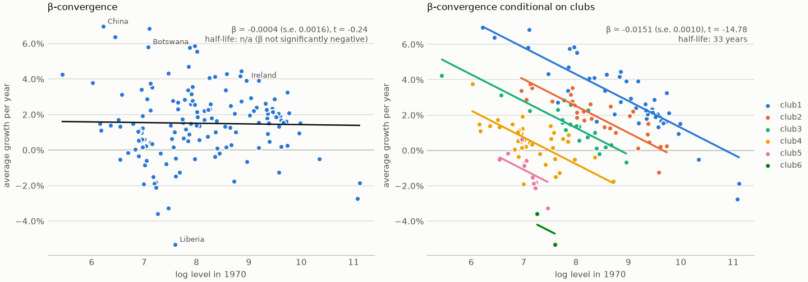
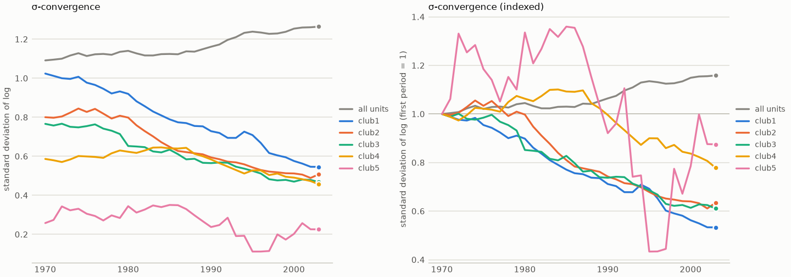
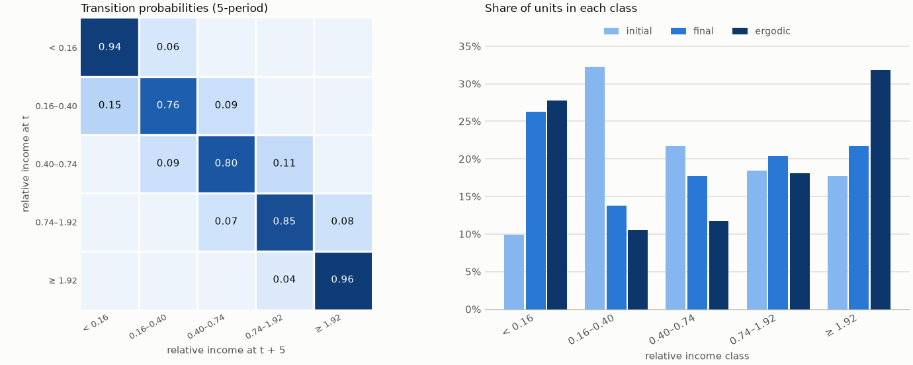
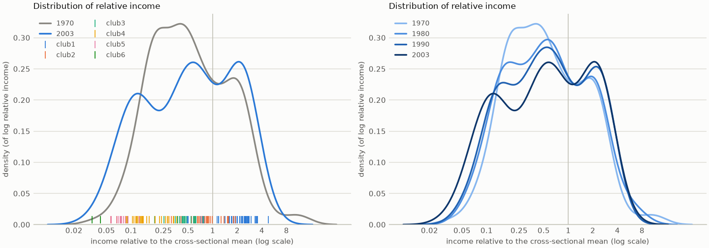
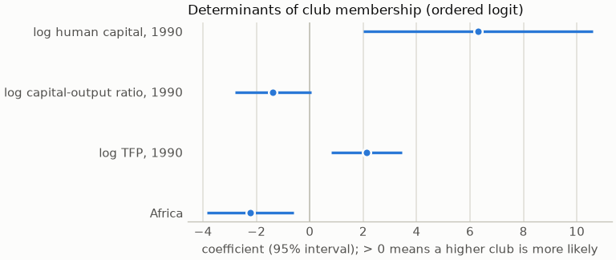

# β, σ, distribution dynamics, pairwise tests and determinants

Classical convergence measures that complement the clubs, and what explains club membership.

[← Back to the README](../README.md)

## β-convergence

β-convergence (Barro and Sala-i-Martin, 1992) asks whether poorer units grow faster. It
regresses average growth on the initial log level:

    g_i = (ln y_iT − ln y_i0) / T = a + β ln y_i0 (+ controls) + e_i

β < 0 means convergence, at speed λ = −ln(1 + βT)/T and with half-life ln 2 / λ. When the
whole panel does *not* converge but units within groups do, that is exactly the situation
that convergence clubs describe.

```python
gdp = cc.load_gdp()                                  # levels, not HP-filtered
cc.beta_convergence(gdp)                             # absolute: β, s.e., t, p, speed, half-life
cc.beta_convergence(gdp, controls=covariates)        # conditional on covariates (indexed by unit)
fit = cc.beta_convergence(gdp, clubs=merged, club_effects=True)   # club intercepts
fit.summary()       # coefficient table
fit.by_club()       # a separate β regression within each club
fit.plot()          # figure below (right panel)
```

Standard errors are HC1 by default (Stata's `robust`); `cov_type="HC0"` and `"nonrobust"` are
also available. p-values use the Student t distribution. Estimates match statsmodels in the
tests. When 1 + βT ≤ 0 the speed formula is undefined, and speed and half-life are NaN.



On the GDP data there is no absolute convergence: β ≈ 0 and p = 0.81. Conditional on the clubs
β is clearly negative (t = −14.8, half-life about 33 years), and it is negative within every
club with enough members.

## σ-convergence

σ-convergence asks whether the cross-sectional dispersion shrinks over time. It is not implied
by β-convergence: poorer units can grow faster while shocks keep the spread constant.

```python
sigma = cc.sigma_convergence(gdp, clubs=merged)   # measure="sd" (default), "var" or "cv"
sigma.series      # dispersion per period: all units and each club
sigma.trend()     # slope per year, Newey-West s.e., change first -> last, converging?
sigma.plot(index=True)                            # figure below (right panel)
```

The trend test regresses the dispersion on time with Newey–West standard errors, because
dispersion is strongly autocorrelated from one year to the next. The lag length follows the
rule ⌊4(T/100)^(2/9)⌋ unless you set `hac_lags=`, and the estimates match statsmodels in the
tests. Clubs with fewer than `min_units=3` units are left out: the spread of two units is just
the gap between them, which is too noisy to read as a trend.



On the GDP data, the dispersion across all countries *rises* by 16% between 1970 and 2003
(σ-divergence), while it falls significantly within each of the five clubs with at least 3
countries.

## Distribution dynamics and twin peaks

β and σ reduce the cross-section to one number. Quah (1993, 1996) looked instead at the
*shape* of the distribution and how units move within it. His "twin peaks" (the world splitting
into a rich and a poor group) are the distributional counterpart of convergence clubs.

```python
dyn = cc.distribution_dynamics(gdp, lag=5, clubs=merged)   # 5 quantile classes of y / mean(y)
dyn.matrix          # transition probabilities between classes over 5 years
dyn.distributions() # initial, final and ergodic (long-run) shares of each class
dyn.summary()       # Shorrocks mobility, |λ2|, half-life to the ergodic distribution
dyn.composition()   # how many units of each club are in each class
dyn.plot()          # transition matrix and class distributions (first figure)
dyn.plot_densities()                  # kernel densities, with each club's units as a rug
```

Income is taken relative to each year's cross-sectional mean, so common growth doesn't move
units between classes. By default the classes are quintiles of the pooled distribution; you
can set `bounds=[0.25, 0.5, 1, 2]` instead. The densities are kernel estimates of *log*
relative income, which avoids putting mass below zero, drawn on a log axis (Silverman
bandwidth). They match scipy's `gaussian_kde` in the tests.





On the GDP data, the long-run distribution piles up at both ends: 28% of countries in the
poorest class and 32% in the richest, against 12% in the middle class. By 2003 the density has
two clear peaks, at about 0.12× and 2× the mean, and the club rugs show which clubs sit under
each peak.

## Pairwise convergence (Pesaran, 2007)

Pesaran's test looks at every pair of units. Two economies converge if the gap between their log
incomes, y_it − y_jt, is **stationary**. `pairwise_convergence` runs an augmented Dickey–Fuller
test on all N(N−1)/2 gaps and reports the share of pairs where the unit root is rejected.
Without convergence that share should be close to the size α of each test; with convergence it
approaches 1. With clubs, the pairs are split into **within-club** and **between-club** pairs,
which gives an independent check on the clustering.

```python
pw = cc.pairwise_convergence(gdp, clubs=merged)   # levels; log=False if already in logs
                                                  # n_jobs=-1 for hundreds of units
pw.summary()     # share rejected: all pairs, within clubs, between clubs, vs alpha
pw.by_club()     # share rejected inside each club
pw.matrix()      # p-values as a units x units table
pw.club_matrix() # share rejected within and between every two clubs
pw.plot()        # that table as a chart; plot(kind="units") for every pair

cc.adf_test(series, regression="c", autolag="AIC")   # the ADF test on its own
cc.kpss_test(series, regression="c", nlags="auto")    # the KPSS test on its own
```

Pesaran confirms the ADF results with the **KPSS** test, whose null is the opposite: stationarity. With
`pairwise_convergence(..., kpss=True)`, `summary()` also reports two shares:
- `share_kpss_stationary`: pairs where KPSS does not reject stationarity;
- `share_both_agree`: pairs where both tests point to convergence, meaning ADF rejects the unit
  root and KPSS does not reject stationarity.

`kpss_test` follows statsmodels' `kpss`: Bartlett-kernel long-run variance and the automatic lag of
Hobijn et al. (1998). Its p-values are interpolated in the KPSS table, so they lie in [0.01, 0.10].
It matches statsmodels on 1,800 series.

`adf_test` follows statsmodels' `adfuller` exactly:
- the maximum lag is ⌈12·(T/100)^¼⌉;
- AIC or BIC chooses the lag on a common sample;
- the chosen regression is refit on the full sample;
- p-values are MacKinnon's (1994).

In the tests, the statistic, the chosen lag and the p-value match statsmodels on 360 series.

On the GDP data the shares are low everywhere (0–20%) and only a little higher within clubs than
between them: the chart uses a fixed 0–100% scale, so weak evidence looks weak.


On the GDP data the unit root is rejected for **12.8%** of all 11,476 pairs (against 5% expected
without convergence). It is rejected for **15.9%** of pairs within clubs and **11.8%** between clubs.
KPSS sharpens the contrast: stationarity is not rejected for **38.9%** of within-club pairs, against
**25.0%** between clubs. Both tests agree on convergence for 8.0% of within-club pairs and 5.8% of
between-club pairs. The ordering is the one the clubs predict, but the shares are low. With 34 annual
observations, an
ADF test has little power against slow convergence, which Pesaran (2007) himself discusses. On a
simulated panel with a stationary gap inside each group and a unit root between groups, the tests
reject for over 80% of within-group pairs and under 30% of between-group pairs. So read low shares
on short real panels as weak evidence, not as evidence against convergence.

The CLI option is `--pairwise`, which runs both tests.

## What explains club membership?

Once the clubs are known, applied papers usually ask which initial conditions predict
membership (e.g. Bartkowska and Riedl, 2012). `club_determinants` estimates an **ordered logit
or probit** of the club rank. Higher values mean a club with a higher relative level, so a
positive coefficient makes a higher club more likely. Divergent units are left out.

```python
lp = cc.load_productivity("lp")
clubs = cc.find_clubs(cc.hp_filter(np.log(lp)), convention="Stata", time_trim=0.333).merge("PS")
covariates = pd.DataFrame({
    "log human capital, 1990": np.log(cc.load_productivity("h")[1990]),
    "log capital-output ratio, 1990": np.log(cc.load_productivity("ky")[1990]),
    "log TFP, 1990": np.log(cc.load_productivity("tfp")[1990]),
    "Africa": (cc.productivity_info()["region"] == "Africa").astype(float),
})
fit = cc.club_determinants(clubs, covariates)          # model="probit" also available
fit.summary()           # coef, s.e., z, p, odds ratios
fit.predict_proba(covariates)                          # probability of each club
fit.plot()
```



The estimator is maximum likelihood with Newton–Raphson steps and analytic gradients. Standard
errors come from the observed information. Coefficients, standard errors and thresholds match
statsmodels' `OrderedModel` in the tests. `report(..., covariates=...)` adds this section to the
report, and the CLI option is `--determinants covariates.csv`.

In this example, higher human capital and TFP in 1990 make a higher productivity club more
likely, and being in Africa makes it less likely (pseudo-R² = 0.55).
