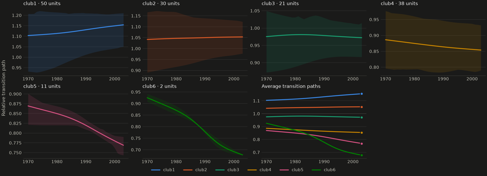
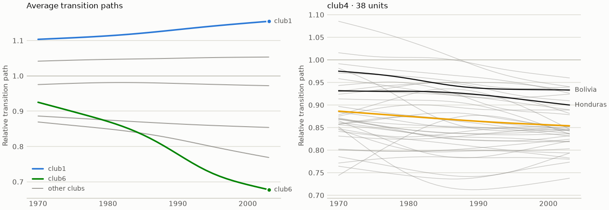
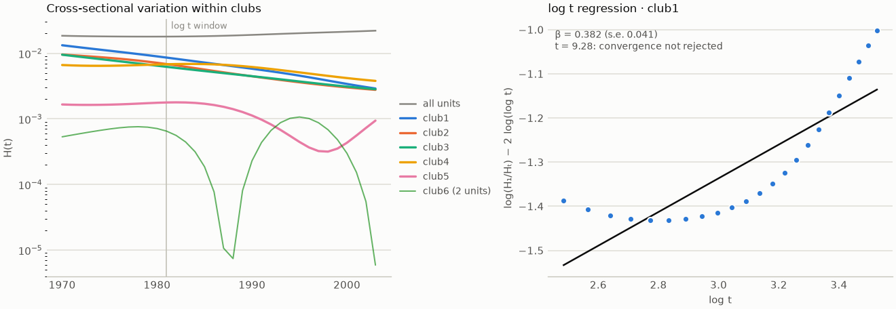

# Plots, interactive charts and maps

[← Back to the README](../../README.md)

## Plots

Plotting needs the `plot` extra (matplotlib). Every plot is available from the result,
and as a function that draws into an existing `ax`:

| Call | Shows |
|---|---|
| `result.plot()` | A grid with one panel per club, then the club averages (returns a `Figure`) |
| `result.plot.club("club4")` | Every unit's path in one club, with the club average |
| `result.plot.average()` | The average transition path of each club |
| `result.plot.variation()` | Cross-sectional variation H(t) within each club. H shrinks when a club converges. |
| `result.plot.log_t("club1")` | The log t regression behind a club's test: points, fitted line, β and t |

```python
merged.plot(ncols=4)
```


```python
merged.plot(ncols=4, theme="dark", units="band")   # quantile band instead of one line per unit
```



```python
import matplotlib.pyplot as plt

fig, axes = plt.subplots(1, 2, figsize=(11, 3.8), layout="constrained")
merged.plot.average(ax=axes[0], emphasis=["club1", "club6"])   # gray out the other clubs
merged.plot.club("club4", ax=axes[1], highlight=["Bolivia", "Honduras"], reference_line=True)
```



```python
fig, axes = plt.subplots(1, 2, figsize=(11, 3.8), layout="constrained")
merged.plot.variation(ax=axes[0])
merged.plot.log_t("club1", ax=axes[1])
```



### Interactive charts

With the `interactive` extra (`pip install "convergence-clubs[interactive] @ git+..."`, which
adds plotly), every main chart has an interactive version:
- hovering shows the unit's name;
- clicking a club in the legend hides or shows all of its lines;
- the club-averages and σ charts show every group at the year under the cursor.

The colors match the matplotlib plots, and `write_html()` saves a standalone page you can
share:

```python
merged.plot.interactive()                          # transition paths (kind="clubs" | "average" | "both")
merged.plot.interactive(kind="average", theme="dark").write_html("clubs.html")
runs.plot_interactive()                            # co-membership heatmap (sensitivity / bootstrap)
cc.beta_convergence(gdp, clubs=merged).plot_interactive()
cc.sigma_convergence(gdp, clubs=merged).plot_interactive(index=True)
```

From the command line, `--html clubs.html` writes the interactive transition paths.

### Maps

With the `maps` extra (geopandas), `result.plot.map(geodata)` colors each region by its
club. Divergent units are shown in gray, and regions without data in a light neutral fill.
Pass a bootstrap result as `confidence=` to draw uncertain members lighter.

```python
import geopandas as gpd

world = gpd.read_file(".../ne_50m_admin_0_countries.zip")      # Natural Earth boundaries
merged.plot.map(
    world, key="ISO_A3_EH", names=cc.country_codes(),        # match countries by ISO3 code
    crs="EPSG:8857",                                          # Equal Earth projection
    confidence=cc.bootstrap(data, 200, merge="PS", seed=0),   # lighter = less certain
)
```

By default units are matched to regions by name. `names=` maps unit names to region keys when
they differ; `cc.country_codes()` gives verified ISO3 codes for the bundled GDP data.
`cc.match_regions()` lists which units were matched, and units with no region are reported
in a warning rather than silently dropped. From the command line, use
`--map clubs.png --geodata regions.gpkg --geo-key NAME`.


### Customizing plots

- **Colors.** `colors=["#000", ...]` (in club order) or `colors={"club2": "crimson"}`.
  Each club keeps its color in every panel, even if you plot only some of the clubs.
  The default palette has 8 colors that stay distinguishable for color-blind readers.
  From the 9th club on, the colors repeat with dashed lines, so no hard-to-distinguish new colors are added.
- **Themes.** `theme="light"`, `"dark"` or `"print"`, or your own `cc.Theme`, e.g.
  `cc.LIGHT.with_colors([...])` or `cc.DARK.replace(font_size=11)`.
  - `"print"` is black and white for journals: three grays, each drawn solid, dashed, dotted and dash-dotted, so twelve clubs stay distinguishable without color.
  - `Theme.linestyles` sets the line style of each round of colors (by default solid, then dashed).
- **Default theme.** Set it once instead of passing `theme=` to every plot:

  ```python
  cc.set_theme("print")                       # every later plot, interactive chart, map and report
  with cc.theme_context("dark"):              # only inside the block
      merged.plot()
  cc.register_theme("paper", cc.PRINT.replace(font_size=8))   # then theme="paper" anywhere
  ```

  An explicit `theme=` always wins. `cc.report(theme=..., dark_mode=...)` also accepts a theme for the main figures and for the dark variant (or `dark_mode=False`).
- **Grid** (`plot()`):
  - `clubs=` picks which clubs to draw;
  - `kind="clubs" | "average" | "both"`;
  - `ncols=`, `panel_size=`, `sharey=True`, `title=`, `ylabel=` and `legend=False` control the layout.
- **Club panels:**
  - `units="lines" | "band" | "none"`, with `band=(0.1, 0.9)` setting the quantiles;
  - `highlight=[unit names]`;
  - `reference_line=True` draws h = 1;
  - `unit_kws=` / `average_kws=` are passed to matplotlib.
- **Average panel:**
  - `emphasis=` keeps the chosen clubs in color and grays the rest;
  - `direct_labels=True | False | "auto"`;
  - `line_kws=` is passed to matplotlib.
- Periods on the x-axis can be numbers (years), dates, pandas periods or strings.
- Every plot is drawn from `result.transition_paths()`, so the same values are also available as a table.
