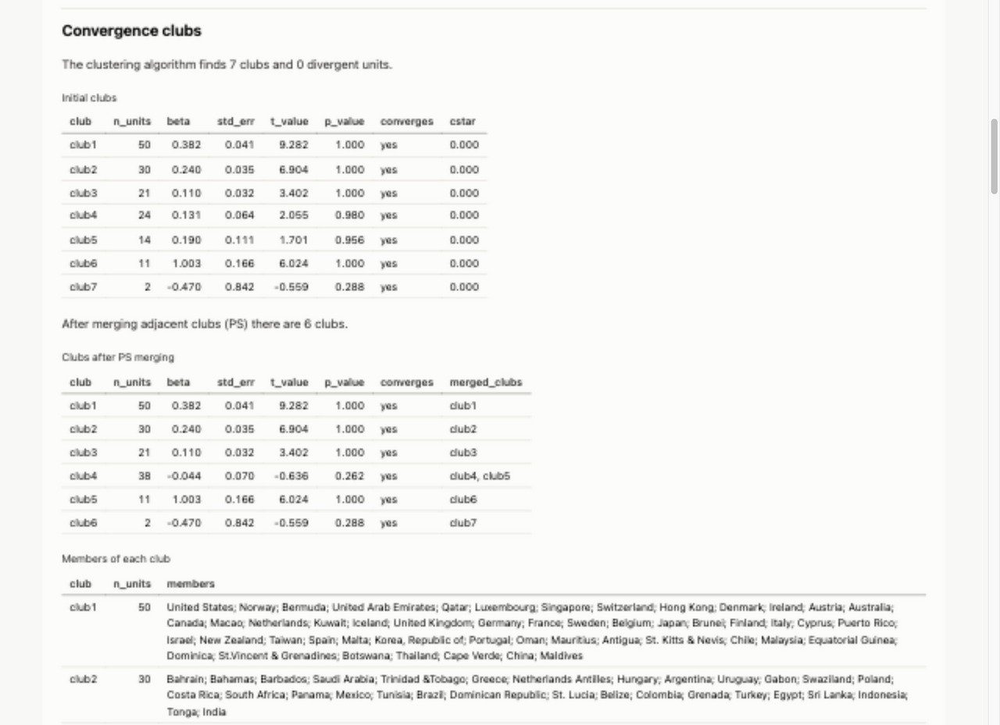

# The report and the command line

[← Back to the README](../README.md)

## The report: every analysis in one file

```python
cc.report(cc.load_gdp()).save("appendix.html")   # levels in; log, HP filter, everything else
```

`report()` runs the standard pipeline on data in levels:
- the log t test on the whole panel;
- the clubs and the merged clubs, with their members;
- a sensitivity grid and a bootstrap of membership confidence;
- β- and σ-convergence;
- distribution dynamics.

It writes **one self-contained HTML file**:
- tables are real HTML, so you can read and copy them; long ones are folded;
- figures are embedded, in light and dark versions that follow the reader's system theme;
- a settings table records every choice that affects the clubs, and the methods section lists
  the references.

Each section can be turned off (`sensitivity=False`, `bootstrap=0`, `beta=False`, …), and the
clustering options (`convention=`, `time_trim=`, `cstar=`, …) are passed through. From the command
line: `convergence-clubs gdp.csv --log --hp-filter --merge PS --report appendix.html`.



See [`docs/report-example.html`](../report-example.html) for the full example on the GDP data
(about 1.3 MB, built in about 5 seconds).

## Command line

```bash
convergence-clubs gdp.csv --log --hp-filter --merge PS \
    --memberships clubs.csv --summary summary.csv --plot clubs.png --theme dark
```

The CSV file must have units in rows and periods in columns. For a long-format file, use
`--long COUNTRY YEAR GDP`, giving the unit, period and value columns. Other options:
- `--convention Stata` (or `--core-rule max_t`), `--time-trim 1/3`, `--hac AQSB`, `--cstar`,
  `--cstar-method incremental`;
- `--iterate-merge` and `--divergent-method last_club` for Stata's `imergeclub` options;
- `--sort-fraction 0.1`;
- `--jobs -1` to run the sensitivity grid, the bootstrap, the pairwise tests and the report in parallel;
- `--club-names "High; Middle; Low"` to name the final clubs (separated by semicolons);
- `--merge-divergent`, optionally with `--joint-divergent`;
- `--fill-gaps 2` and `--drop-incomplete` for panels with missing values;
- `--details`, which prints the members of every club;
- `--latex clubs.tex`, which writes the clubs and their members as a LaTeX table;
- `--summary out.csv --members`, which writes the summary table with the members of each club;
- `--theme light | dark | print | journal` and `--dpi 300` for every saved figure and the report.

`--sensitivity` reruns the clustering with `time_trim` set to 1/3, 0.25, 0.3 and 0.4, each with
FQSB and AQSB. It prints the agreement table and the least stable units, and
`--sensitivity-plot FILE` saves the heatmap.

`--beta` estimates β-convergence on the unfiltered data, absolute and conditional on the clubs,
and within each club. `--beta-plot FILE` saves the figure.

`--sigma` reports the trend of dispersion overall and within each club, and `--sigma-plot FILE`
saves the indexed figure.

`--dynamics` prints the transition matrix, the class distributions and the clubs in each
class. The defaults are 5 classes and 5-year transitions (`--dynamics-classes`,
`--dynamics-lag`), and `--dynamics-plot FILE` saves the figure.

`--bootstrap 200 --bootstrap-method units|cycle|endpoint --seed 0` reports the mean agreement
with the full-sample clubs and the units with confidence below 0.8. With `--hp-filter`, every
replicate is filtered again.

Run `convergence-clubs --help` for the full list, or call it as `python -m convergence_clubs`.
