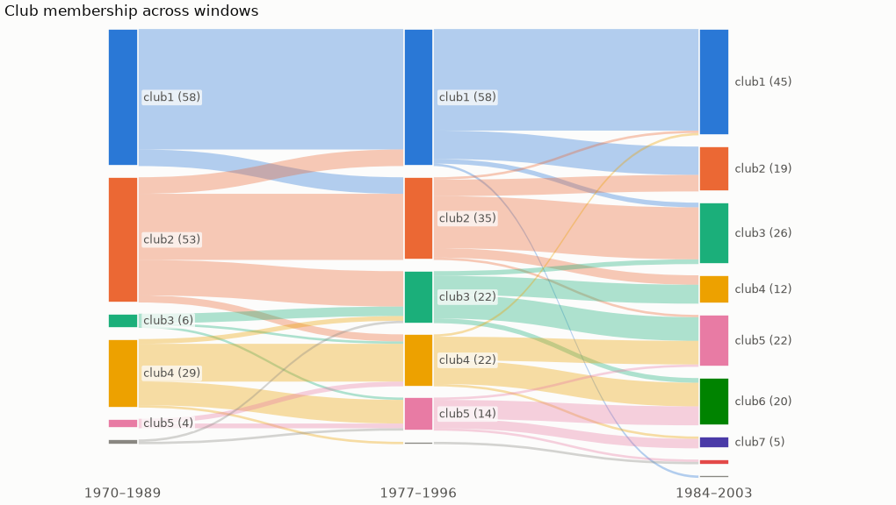

# Robustness: sensitivity and bootstrap

How stable are the clubs when the settings or the data change?

[← Back to the README](../README.md)

## Sensitivity analysis

Club memberships depend on the trimming fraction, the HAC estimator, `c*`, merging and how
units are ordered. On the GDP data, for example, FQSB gives 7 clubs and AQSB gives 5 clubs
plus 3 divergent units. `sensitivity()` reruns the procedure over a grid of settings. The
first value of each setting forms the baseline run.

```python
runs = cc.sensitivity(
    data,
    time_trim=[1/3, 0.25, 0.3, 0.4],   # defaults
    hac_method=["FQSB", "AQSB"],       # defaults
    cstar=[0, -1],
    merge=[None, "PS"],
)
runs.table()          # one row per run: settings, clubs, sizes, agreement with the baseline (ARI)
runs.stability()      # per unit: share of runs spent with its baseline club mates
runs.co_membership()  # units x units: share of runs in the same club
runs.plot()           # heatmap below

cc.compare_clubs(a, b)          # crosstab of two results' memberships
cc.adjusted_rand_index(a, b)    # 1 = identical memberships, 0 = chance agreement
```

In the heatmap, a club that stays together in every run shows as a solid dark block. Lighter
stripes are units that change clubs between runs.


## Bootstrap confidence in club membership

`sensitivity()` varies the *settings*. `bootstrap()` perturbs the *data*, and tells you how
confident you can be that a unit belongs to its club. There are three resampling schemes:

| `method=` | What it varies | Question it answers |
|---|---|---|
| `"units"` (default) | Cluster random 80% subsets of the units | Does a unit's club depend on which other units are in the sample? |
| `"cycle"` | Block-resample the HP cyclical component and filter again (needs the *unfiltered* data and `filter_lambda=`) | Is the club robust to business-cycle noise? |
| `"endpoint"` | Drop the last 1…`max_drop` periods | Does the club hinge on the last years, where the HP filter is least reliable? |

Years are never resampled independently: the log t regression depends on the time index, so
shuffling periods would be meaningless. The cycle bootstrap uses the same blocks for every
unit, so shocks that hit all units at once stay common.

```python
runs = cc.bootstrap(data, 200, method="units", seed=0)   # ~3 s on the GDP data
runs.stability()          # each unit's confidence in its full-sample club, and runs included
runs.uncertain(0.8)       # units below 80% confidence, least confident first
runs.plot_stability()     # figure below
runs.plot()               # co-membership heatmap, as for sensitivity()

raw = np.log(cc.load_gdp())
cc.bootstrap(raw, 200, method="cycle", filter_lambda=400, merge="PS", seed=0)
```

## Clubs over time

Are the clubs stable, or do countries move between them? `rolling_clubs` runs the clustering
in windows of `window` periods, `step` periods apart (by default half a window; the last
window always ends with the last period). With `filter_lambda`, the unfiltered logs are
HP-filtered within each window, so no window sees later data through the filter.

```python
rolled = cc.rolling_clubs(np.log(gdp), window=20, step=7, filter_lambda=400)   # merge="PS"
rolled.summary()        # clubs per window and agreement (ARI) with the previous window
rolled.transitions()    # units in each club of the first window (rows) and the last (columns)
rolled.movers()         # units that left their club mates, and in which direction
rolled.plot()           # flows between windows, below; rolled.plot_interactive() as a Sankey
```

Club numbers are a rank within each window: with more clubs in a later window everyone gets a
higher number, so they cannot be compared directly. `movers()` therefore compares each country
with its own club mates: if most of them go to club c and the country goes elsewhere, it moved,
`"up"` if its new club is above c and `"down"` if below. On the GDP data, Brazil, Hungary and
Panama fall behind their club mates of 1970–1989, while Argentina moves ahead of its own.



Each bar is a club, highest on top; band widths are the number of countries going from one
club to the next. Club 1 of 1970–1989 (58 countries) keeps 41 of them in club 1 of 1984–2003,
while the 53 countries of the second club of 1970–1989 spread over six clubs. With 20-year
windows and `time_trim=1/3` the log t regression uses only the last 13 periods of each window, so
read single movements with care.

From the command line: `--rolling 20 --rolling-step 7 --rolling-plot rolling.png`.

### Large panels

`sensitivity()`, `bootstrap()`, `pairwise_convergence()` and `report()` take `n_jobs=` to run
in several processes (`-1` uses every CPU, `-2` all but one; the default `1` runs serially).
All random draws are made before the work is split, so the result is the same for any
`n_jobs`; the tests check this. In the command line, use `--jobs N`.

Median of 5 alternating runs on a 12-core laptop, with a synthetic panel of 1,000 units and 40 periods
(`scripts/benchmark_jobs.py`; timings vary with the panel, mainly for `bootstrap`):

| Call | `n_jobs=1` | `n_jobs=-1` |
|---|---|---|
| `bootstrap(data, 100)` | 9.8 s | 1.5 s |
| `sensitivity(data)` (8 runs) | 1.6 s | 0.5 s |
| `pairwise_convergence` on 400 units (79,800 pairs) | 3.7 s | 0.9 s |

The pairwise test grows with the square of the number of units, so it matters most there.
Each ADF test chooses its lag from up to 13 nested regressions; one QR decomposition gives all
of them, which made the test about 3.7 times faster than fitting each regression (14.7 s → 3.9 s on
the 400 units above). The results do not change: they match statsmodels' `adfuller` on 2,000
GDP gaps.


On the GDP data, Somalia, Burkina Faso and Vanuatu are among the 8 least confident units
under all three schemes. Club 1 is solid when units are resampled (every member ≥ 0.94) and
fairly solid under cycle resampling (≥ 0.80). Dropping the last years, however, moves some of
its members (down to 0.45), so the end of the sample matters for the top club.
